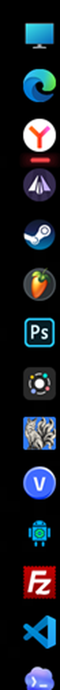
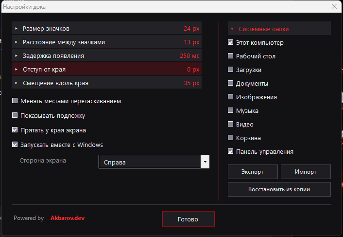
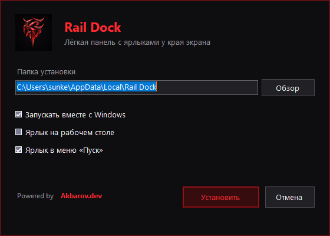

# Rail Dock

Лёгкая панель с ярлыками у края экрана для Windows.

Выезжает, когда подводишь курсор к краю. В остальное время её не видно.

**Бесплатно. Без рекламы. Без интернета. Без сбора данных.**

---

## Зачем

Рабочий стол зарастает ярлыками, панель задач переполняется, меню «Пуск» долго листать. Rail Dock держит нужное под рукой и не занимает места: панель прячется за край и появляется по движению курсора.

Делалась как замена тяжёлым докам, которые подтормаживают на обычном ноутбуке.

## Что умеет

- Любая из четырёх сторон экрана: слева, справа, сверху, снизу
- Автоскрытие с настраиваемой задержкой появления
- Размер значков, расстояние между ними, отступ от края, смещение вдоль края
- Перетаскивание значков мышью
- Системные папки одной галочкой: «Этот компьютер», корзина, панель управления, папки пользователя
- Системное контекстное меню для них — «Управление», «Свойства», «Службы» — в тёмном оформлении
- Отметка запущенных программ: под значком загорается полоска
- Клик по запущенной программе поднимает её окно, двойной клик открывает вторую копию
- Невидимые значки-разделители, чтобы разбивать ярлыки на группы
- Экспорт и импорт настроек одним файлом
- Автоматические точки отката: перед каждым изменением сохраняется копия списка
- Подложку можно выключить — останутся только значки на обоях

## Установка

1. Скачайте `RailDock-Setup.exe` из раздела [Releases](../../releases)
2. Запустите, выберите папку, нажмите «Установить»

Права администратора не нужны. Установка идёт в папку пользователя.

Удаление — через «Программы и компоненты» или `Uninstall.exe` в папке программы.

**Требуется:** Windows 10 или 11. Ничего доустанавливать не нужно — .NET Framework 4.8 входит в состав системы.

## Безопасность

Программа скачивается собранной, без исходного кода. Поэтому ниже — что именно она делает, чтобы это можно было проверить.

**Интернета не касается.** В коде нет ни одного сетевого вызова. Единственное обращение наружу — если вы сами нажмёте ссылку на сайт автора в настройках, она откроется в браузере.

**Данные не собирает.** Ни статистики, ни идентификаторов, ни отправки чего-либо куда-либо.

**Рекламы нет.** Ни баннеров, ни предложений, ни партнёрских установок.

**Что пишет на диск.** Только внутри своей папки:

| Файл | Назначение |
|---|---|
| `items.ini` | список ярлыков, обычный текст |
| `settings.ini` | настройки, обычный текст |
| `backups/` | точки отката списка ярлыков |

Оба файла можно открыть блокнотом и прочитать.

**Что пишет в реестр.** Одно значение в `HKEY_CURRENT_USER`, если включён автозапуск. Установщик добавляет запись для «Программ и компонентов». В системные разделы не пишет ничего.

**Запускает ли что-то.** Только то, что вы сами добавили в док, и только по вашему клику.

**Контрольные суммы** каждой сборки публикуются рядом с файлом в Releases — можно сверить скачанное.

**Исходный код** закрыт, но предоставляется по запросу для проверки. Напишите, если нужно.

## Скриншоты

**Настройки**

**Установщик**

## Известные ограничения

- Работает только с основным монитором
- Не подстраивается под масштабирование Windows: на экране с масштабом 150% размер значков нужно увеличить вручную
- Для программ из Microsoft Store отметка «запущено» срабатывает не всегда — зависит от того, как оформлен ярлык

## Лицензия

Бесплатно для любого использования, включая коммерческое.

Нельзя продавать, выдавать за свою разработку, убирать сведения об авторе и распространять изменённые версии.

Полный текст — в файле [LICENSE](LICENSE), а также внутри самой программы: Настройки → Лицензия.

---

Автор — [Akbarov.dev](https://akbarov.dev)
